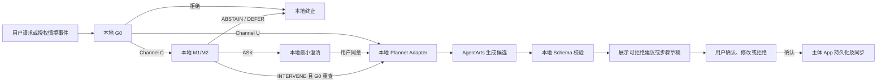

# Local Policy ↔ AgentArts Provider 契约提案

## 2026-11-17 平台草稿与契约差异

当前唯一平台草稿是 `FA_TaskPlanner_v0_1`（ID `1542f0de-f841-46a0-875d-cfd2d34d2263`）。Start 输入键是 `query:String`，值为本地 G0/Policy 处理后的最小 JSON 字符串；`channel` 文本当前只接受 `USER_REQUEST` 或 `AUTHORIZED_CONTEXT_EVENT`，不得把它们直接当成本地 `WorkflowEvent.channel='USER'|'CONTEXT'` 枚举。原任务目标中的 `CONTEXT_TRIGGER` 是入口描述，不新增为共享枚举。模型输出为 `raw_output:String`；End 以 `result` 引用并在预览中返回最终文本。平台草稿不含 G0/M1/M2、任务写入、端侧推送、KB、Plugin、MCP 或 Personal Memory。

第二次预览实际返回的八字段草稿为 `resultType/sourceEventId/correlationId/title/userGoal/steps/question/errorCode`。`resultType` 仅 `STEP/CLARIFY/ERROR`；它不是 `WorkflowV21Contracts.ts:TaskPlan`，也没有冻结的 `FirstStepResult` wire Schema。后端 `scripts/agentarts-planner-draft.mjs` 对观察到的最终文本做严格 JSON、字段、关联 ID 与分支互斥校验。候选绑定 `scripts/agentarts-planner-provider.mjs` 在假 SSE 中按草稿配置读取 `outputs.result`；这是**待真实 API 验证的假设**，并非平台 Runtime 响应证据。绑定的输入白名单只允许提示词列出的字段，拒绝额外生理/位置字段；G0 与授权仍由调用方负责。这些模块不生成 `TaskPlan`/Action；真实输出包络须由一次正式 API 证据确认。首次预览证明直接把对象插入 End 回复会产生不合法的单引号字符串，不能以节点 Success 代替解析断言。

`AgentArtsPlannerMapping.ts` 现在提供一个**未接线的纯 STEP 映射**：计划 ID、修订号、各步骤 ID、预计启动时间和 Provider 来源必须由本地调用方提供，模型文本不能铸造这些身份；映射后再调用既有 `validateTaskPlan`。它用平台预览文本离线回放通过 6 项断言，不代表 ID 生成策略或真实 Provider 接入已冻结。`TaskPlan 2.1.0` 的 ID 策略、CLARIFY/ERROR 处理、真实来源和确认状态仍需本地桥接与共享契约审批。不得通过修改已通过测试的 `WorkflowV21Contracts.ts` 或把平台草稿直接持久化来绕过。正式 API 鉴权和 SSE 映射依然 **BLOCKED/NOT_RUN**；平台预览 **PASS/E2**；本地 STEP 映射 **PASS/E1（回放）**。

状态：**PROPOSED / E0**。本文件定义集成边界，不修改已通过测试的 `WorkflowV21Contracts.ts`，也不宣称 `FirstStepResult` wire 类型已冻结。共享契约差异仍由 `Wang-B-Agent/design/workflow-v2.1/v2.1-contract-change-proposal.md` 管理。

## 控制流

Channel U 的合法请求不经 M2；两通道的本地 G0 均不能由平台输出覆盖。Local Policy 应在 AgentArts 不可用时独立完成阻断、ABSTAIN、DEFER 和安全判断。

这是**目标协同流程**。当前 `WorkflowV21Router.ts:158-197` 对 `INTERVENE` 先生成本地候选建议，用户接受后才调用 Planner；它尚未执行“G0 后调用 AgentArts 生成建议”。改变这一调用时点会影响授权、确认与状态机，须单独评审和回归，不能将现有 WF-08 的 Mock PASS 当作目标流程已实现。

## 接线前的文件级变更评审

以下是待批准的接口决策，**不是已实施功能**。当前本地离线联接测试只覆盖 `STEP` 和合成 Runtime 包络；平台预览仅覆盖 `USER_REQUEST`。共享契约的上位提案见 `Wang-B-Agent/design/workflow-v2.1/v2.1-contract-change-proposal.md`，未经审批不改 `WorkflowV21Contracts.ts`、状态机或设备协议。

| 缺口与现有证据 | 拟影响文件 | 审批后所需行为及验收 |
|---|---|---|
| `WorkflowV21Router.ts:119-126` 对 Planner 返回值只运行 `validateTaskPlan`；平台草稿还有 `CLARIFY/ERROR`。 | `WorkflowV21Contracts.ts`、`WorkflowV21Router.ts`、`WorkflowV21Validation.ts`、`AgentArtsPlannerMapping.ts`、App UI 结果映射与相关测试。 | 冻结带版本和来源的 Planner 结果包络；`STEP` 进入待确认草稿，`CLARIFY` 仅展示最小问题，`ERROR` 记录可追踪失败且不持久化。旧 Mock `TaskPlan` 路径需兼容，未知类型安全拒绝。 |
| `WorkflowV21Router.ts:158-197` 的 `INTERVENE` 先生成本地建议，接受后才调 Planner；本轮 WF-08 直接断言了这一调用时点。 | `WorkflowV21Router.ts`、用户建议/确认路径、审计日志和 WF-08/11/12/17 及新集成测试。 | 明确 G0/M2 通过后是否允许在用户接受前调用 AgentArts 生成候选，以及 ASK 何时视为用户同意；两种选择均需二次 G0、拒绝/静默无 Action、超时安全降级及调用计数断言。不能把平台生成候选当作用户授权创建 Task。 |
| `AgentArtsPlannerMapping.ts` 要求调用方提供 planId、revision、stepIds、来源；`ProviderInfo.kind` 只有 `mock/real`。 | 本地 ID 生成/Provider 适配、`WorkflowV21Contracts.ts`、迁移和来源测试。 | 本地权威组件生成稳定业务 ID，模型不能自报已执行或已送达；区分 Mock、Replay 与真实 AgentArts 来源，旧记录可读且不会被冒充为真实结果。 |
| `scripts/agentarts-planner-provider.mjs` 当前假定终结 SSE 的 `outputs.result`；平台草稿没有 Runtime Name 或正式响应证据。 | 受控后端配置/凭证管理、Provider Adapter、SSE 解析及 App 桥接测试。 | 提交版本后以脱敏合成任务核实实际 Runtime 域名、请求/会话 ID、输出键、错误与费用；只有实测通过才启用 `kind='real'`。密钥不入 HarmonyOS 包、仓库或日志。 |

审批后按顺序验证：旧 `TaskPlan`/旧快照兼容 → USER_REQUEST 的 STEP/CLARIFY/ERROR → Channel C 的 ABSTAIN/DEFER/ASK/INTERVENE 与授权撤销 → 拒绝、修改、确认和离线恢复 → 真实 API → App 与设备。现有 **E1 离线测试**只能验证候选代码路径，不能代替 E2 平台预览、E3 API 或 E4 端侧回执。

## 现行接口与待批准桥接

现行 `WorkflowDeps.planner.plan({event, existing?, previous?, edit?})` 返回 `unknown`，经 `validateTaskPlan` 接受 `TaskPlan` 2.1.0；`WorkflowV21Router.ts:119-126` 还检查来源事件、taskId、修订和 G0。平台请求候选字段：`requestId`、`correlationId`、`sourceEventId`、`taskId?`、`userGoal`、`existingStepSummary?`、`edit?`、`language`、`channel`、`schemaVersion`。仅传必要的、已授权文字；默认不传原始传感器、心率、音频、精确位置、闪念沙盒、个人记忆或授权凭证。

| 状态 | 适配规则 |
|---|---|
| `STEP` | 从平台终结事件取结构化内容，严格 JSON 解析并映射到现行 `TaskPlan`；再运行本地校验。平台不自报已确认/已执行。 |
| `CLARIFY` | 本地展示一个最小问题；当前 `WorkflowV21` 没有通用 `FirstStepResult` wire 映射，不能擅自注入 `TaskPlan`。 |
| `ERROR` | 返回可追踪失败码，禁止自动持久化或交付。 |

`UiStepResult` 位于 `pages/UiReadModels.ts:29-38`，是 UI 读取模型，不能直接作为 Provider 传输 Schema；其 `STEP.source='AGENT'` 也不能用于 Replay/Rule。现有 `ProviderInfo.kind` 仅为 `mock/real`，不能完整表达 `REPLAY/RULE/AGENTARTS`。增加来源枚举、wire 包络及兼容迁移需要共享契约审批。

## AgentArts 传输适配

官方接口是 `POST /runtimes/{runtime_name}/invocations`；`inputs` 名称由实际开始节点决定，返回 SSE 事件流。Adapter 必须只接受匹配 requestId/correlationId 的终结结果；不能把 `message` 片段或 `node_finished` 当成完整计划。遇 `error`/`exception`、流中断、超时、无终结事件、无效 JSON、未知 schemaVersion 或关联 ID 不符时安全失败。记录脱敏 requestId、sessionId、workflow/runtime 版本、耗时、错误码；不记录密钥和敏感输入。API Key 仅允许受控后端/凭证管理，绝不进入 HarmonyOS 包或仓库。

草稿的输入键 `query` 和 End 输出键 `result` 已在平台预览观察到；正式 API 的实际 `runtime_name`、访问域名、终结输出包络仍未取得。2026-11-17 账号模型授权页显示所选 `GLM 5.2-ArkTS-SPARK` 已订阅且按 Token 计费，但费用上限与真实 Runtime 调用仍未验证，因此此契约不能标为已接入。参考华为云[调用 API](https://support.huaweicloud.com/api-agentarts/InvokeRuntime.html)及[响应事件](https://support.huaweicloud.com/api-agentarts/agentarts_07_0056.html)。

离线传输边界已新增 `entry/src/main/ets/services/AgentArtsSse.ts`：只从成功的 `workflow_finished.data.outputs` 取最终输出，要求流以 `end` 结束，拒绝错误、等待、重复终结、截断及无效 JSON。此函数不发网络请求、不解析项目 `STEP/CLARIFY/ERROR`、不写 AppState；对应人工合成事件测试为 `tests/agentarts-sse.test.mjs`。实际平台输出字段仍待资源盘点后核对。

后端专用 `scripts/agentarts-runtime-client.mjs` 增加了独立的 HTTPS 传输边界。调用方须在受控后端提供实际域名、Runtime Name、鉴权和已授权的最小 `inputs`；模块不读取凭证文件、不记录敏感正文、不进入 HarmonyOS 包。它对离线假响应测试了路径、关联 ID、失败、超时和大小限制；尚未部署，未获取平台实际输入键或调用结果，不能视为已完成 Provider 集成。
